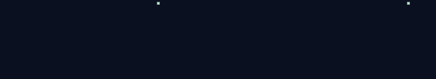
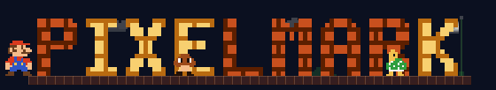
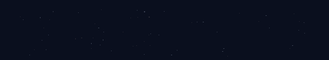
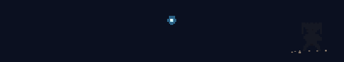
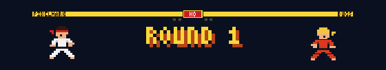

<div align="center">

# pixelmark

**Animated pixel-art wordmarks for React.**

Give it any text and it builds it out of pixels: with a laser, falling sand, Matrix rain, a game of Tetris, or a whole Mario level. Then it takes itself apart and builds it again, a different way each time.

[](https://www.npmjs.com/package/react-pixelmark)
[](https://bundlephobia.com/package/react-pixelmark)
[](https://github.com/chahe-dridi/pixelmark/actions/workflows/ci.yml)
[](https://github.com/chahe-dridi/pixelmark/blob/main/LICENSE)

**[Live gallery](https://pixelmark.vercel.app/gallery)** · **[Playground](https://pixelmark.vercel.app/playground)** · **[Docs](https://pixelmark.vercel.app/docs)**



</div>

---

## Features

- **35 builds.** 19 classic pixel effects and 16 game & story cutscenes, rotated so none repeats until all have played.
- **Variants you control.** Pin Mario to the world map, Star Wars to the duel, or shuffle between the versions you like.
- **Any text.** A–Z, 0–9, `. ! ? - : '`, several lines. Accents are stripped, so `Ingénieur` just works.
- **Light.** One `<canvas>`, a few hundred rectangles a frame, no React re-renders and zero runtime dependencies. Each scene is its own chunk, downloaded only when it is about to play.
- **Polite.** Pauses off-screen and in hidden tabs. Under `prefers-reduced-motion` it draws the finished wordmark once.
- **Themeable.** Seven palettes, a three-colour shorthand, or full control. Follows your light/dark theme.
- **Typed.** TypeScript definitions included, plus a framework-free `mount()`.

## Install

```bash
npm install react-pixelmark
```

React 18 or newer is the only peer dependency. The package is ESM-only and safe to server-render (the engine starts in the browser only).

## Quick start

```jsx
import { Pixelmark } from 'react-pixelmark'

export default function Hero() {
  return <Pixelmark text="Software Engineer" accent="rest" />
}
```

The canvas fills its container's width (up to `maxWidth`) and keeps its aspect ratio. It is exposed to assistive tech as an image labelled with your text; if it stands in for a heading, keep a visually hidden `<h1>` next to it.

## Props

All optional. Any other prop (`id`, `onClick`…) is passed to the `<canvas>`.

| Prop          | Type                                                                     | Default       | Description                                                                          |
| ------------- | ------------------------------------------------------------------------ | ------------- | ------------------------------------------------------------------------------------ |
| `text`        | `string`                                                                 | `'PIXELMARK'` | Text to draw. Case and accents are ignored; `\n` starts a new line.                  |
| `accent`      | `'none' \| 'all' \| 'first' \| 'rest' \| 'last' \| number[] \| fn`       | `'none'`      | Which characters use the accent colour.                                              |
| `palette`     | `PaletteName \| Palette \| { ink, accent, background? } \| { dark, light }` | `'ocean'`     | Colours. See [Palettes](#palettes).                                                  |
| `tone`        | `'auto' \| 'light' \| 'dark'`                                            | `'auto'`      | `auto` follows a `dark`/`light` class or `data-theme` on `<html>`, then the OS.      |
| `build`       | `BuildName`                                                              | —             | Pin one build; it replays every cycle.                                               |
| `builds`      | `BuildName[]`                                                            | all           | Only rotate through these.                                                           |
| `games`       | `boolean`                                                                | `true`        | Include the game & story scenes (single-line text only).                             |
| `variants`    | `{ [scene]: { [key]: value | value[] } }`                               | all random    | Choose scene variants. See [Scene variants](#scene-variants).                        |
| `colorStyle`  | `'bands' \| 'solid' \| 'letters' \| 'mosaic' \| 'stripes'`               | rotates       | Pin one colour style.                                                                |
| `label`       | `string`                                                                 | first word    | Short text some scenes print (XP installer, Street Fighter HUD, Marauder's Map).     |
| `hold`        | `number`                                                                 | `6`           | Seconds the finished wordmark holds before it rebuilds.                              |
| `loop`        | `boolean`                                                                | `true`        | Keep rebuilding. `false` builds once and stays.                                      |
| `interactive` | `boolean`                                                                | `true`        | Pixels dodge the mouse; a click skips to the next build.                             |
| `ambient`     | `boolean`                                                                | `true`        | Loose pixels drift up off the letters while it holds.                                |
| `onBuild`     | `(name: BuildName) => void`                                              | —             | Called each time a build starts.                                                     |
| `maxWidth`    | `number \| string`                                                       | `1100`        | CSS `max-width` of the canvas.                                                       |
| `bleed`       | `boolean`                                                                | `false`       | Pull the blank padding out with negative margins, so letters line up with nearby text. |

A `ref` gives you `{ next(), canvas }`: `ref.current.next()` skips ahead.

```jsx
const mark = useRef(null)

<Pixelmark
  ref={mark}
  text="Hello World"
  accent="last"
  palette="ember"
  builds={['laser', 'matrix', 'mario', 'starwars']}
  onBuild={(name) => console.log('now playing', name)}
/>
<button onClick={() => mark.current.next()}>Next</button>
```

## Palettes

Presets: `ocean` (default, blue), `ember` (orange), `mint`, `violet`, `rose`, `gold`, `mono`. Each has a dark and a light variant.

```jsx
// three colours; the five tones of each are derived
<Pixelmark palette={{ ink: '#F5F5F4', accent: '#F97316', background: '#0C0A09' }} />

// a different palette per theme
<Pixelmark palette={{ dark: { ink: '#FFFFFF', accent: '#22D3EE' }, light: { ink: '#0F172A', accent: '#0891B2' } }} />

// full control: five tones each, index 0 = most contrast against the page
<Pixelmark palette={{ ink: ['#fff', '#ddd', '#bbb', '#999', '#777'], acc: ['#fdba74', '#fb923c', '#f97316', '#ea580c', '#c2410c'] }} />
```

## Accent

```jsx
<Pixelmark text="Software Engineer" accent="rest" />           // ENGINEER
<Pixelmark text="Hello World" accent="first" />                 // HELLO
<Pixelmark text="CUBEXIO" accent={[4]} />                       // only the X
<Pixelmark text="ABC" accent={(ch) => 'AEIOU'.includes(ch)} />  // memoize functions
```

Indices count every character of the text, spaces and line breaks included.

## Builds

### Game & story scenes in action

<table>
  <tr>
    <td align="center"><br><code>mario</code></td>
    <td align="center"><br><code>starwars</code></td>
  </tr>
  <tr>
    <td align="center"><br><code>dragonball</code></td>
    <td align="center"><br><code>streetfighter</code></td>
  </tr>
</table>

Every clip is the library itself, recorded with `npm run media`. Try any build live in the [playground](https://pixelmark.vercel.app/playground).

### All builds

**Classic** (any text, multi-line too): `assemble` `stack` `scan` `rise` `glitch` `converge` `laser` `sand` `lightning` `matrix` `puzzle` `portal` `halftone` `weave` `tetris` `slash` `flip` `ripple` `type`

**Game & story scenes** (single line, each lazily loaded): `mario` `pacman` `snake` `invaders` `xpboot` `streetfighter` `minecraft` `sonic` `amongus` `angrybirds` `donkeykong` `harrypotter` `dragonball` `sahara` `sidibousaid` `starwars`

Many scenes pick random variants each play (Mario or Luigi, which ghosts chase Pac-Man, which Dragon Ball villain shows up…). See them all in the [gallery](https://pixelmark.vercel.app/gallery).

`CATALOG` exports every build's `name`, `title`, `kind`, `tags` and `description` if you want to build your own picker:

```js
import { CATALOG, VARIANTS, CLASSIC_BUILD_NAMES, SCENE_BUILD_NAMES } from 'react-pixelmark'
```

## Scene variants

Most scenes roll their own dice every play: Mario or Luigi, a lightsaber duel or a space battle, which Dragon Ball villain shows up. `variants` lets you decide, per scene. A single value pins it, an array shuffles between only those values, and any key you leave out stays random.

```jsx
<Pixelmark
  text="Hello"
  builds={['mario', 'starwars', 'dragonball']}
  variants={{
    mario: { mode: 'map', hero: 'luigi' },   // always the world map, always Luigi
    starwars: { scene: ['duel', 'space'] },   // a duel or a space battle, never blasters
    dragonball: { mode: 'spirit' },           // the Spirit Bomb, every time
  }}
/>
```

| Scene | Keys |
| --- | --- |
| `mario` | `mode` (run, map) · `hero` (mario, luigi) · `world` (over, under) · `ending` (pipe, flag) · `star` |
| `pacman` | `direction` (ltr, rtl) · `ghosts` (2, 3) · `cherry` |
| `snake` | `screen` (modern, nokia) · `snakes` (many, two) |
| `invaders` | `invader` (mixed, crab, squid) · `ufo` |
| `streetfighter` | `winner` (L, R) |
| `minecraft` | `direction` · `dragon` |
| `sonic` | `direction` · `tails` · `eggman` |
| `amongus` | `story` (kill, eject) · `kill` (knife, tongue) |
| `angrybirds` | `material` (mixed, wood, ice, stone) |
| `donkeykong` | `direction` · `blueBarrels` |
| `harrypotter` | `spell` (map, patronus) · `direction` |
| `dragonball` | `mode` (solo, win, rescue, duo, spirit) · `villain` (broly, frieza, jiren, beerus) · `hero` (goku, vegeta, piccolo) · `form` (base, ssj1, ssj2, ssj3, ssg, ui, transform) · `helper` (vegeta, piccolo) · `direction` |
| `sahara` | `time` (dusk, night, noon) · `camels` (2, 3) · `palm` |
| `sidibousaid` | `doors` (mixed, blue, yellow) · `cat` |
| `starwars` | `scene` (duel, space, blasters) · `blade` (blue, green, purple) · `doubleBlade` · `direction` |

Keys without listed values are `true`/`false`. `VARIANTS` exports all of this with labels, for building your own picker.

## Without React

```js
import { mount } from 'react-pixelmark/vanilla'

const mark = mount(document.querySelector('#logo'), { text: 'HELLO', palette: 'violet', build: 'tetris' })
mark.next()     // skip ahead
mark.destroy()  // stop and clean up
```

Works the same in Vue, Svelte, Astro or a plain page.

## Repository layout

```
pixelmark/
├── packages/pixelmark/        the npm package
│   ├── src/
│   │   ├── Pixelmark.jsx      React component (tiny; loads the engine lazily)
│   │   ├── vanilla.js         framework-free mount()
│   │   ├── catalog.js         build metadata (titles, tags, descriptions)
│   │   ├── registry.js        lazy loaders for the scene chunks
│   │   ├── engine/
│   │   │   ├── engine.js      layout + the animation loop
│   │   │   ├── classic.js     the 19 classic builds, colour styles, exits
│   │   │   ├── glyphs.js      the 13-row pixel font
│   │   │   ├── palettes.js    presets and palette helpers
│   │   │   └── kit.js         shared drawing helpers for builds
│   │   └── builds/            one file per game & story scene
│   └── test/
├── apps/site/                 the showcase site (Vite + React + Tailwind)
│   └── scripts/               prerender (per-route SEO, sitemap) and social-image rendering
└── .github/workflows/         CI and npm release
```

## Development

```bash
npm install
npm run dev       # the showcase site, hot-reloading the library from source
npm test          # library tests
npm run build     # library + site
npm run media     # re-record the README GIFs (needs Chrome; run build:lib first)
```

## Versioning and releases

pixelmark follows [Semantic Versioning](https://semver.org/). Changes are recorded in [CHANGELOG.md](https://github.com/chahe-dridi/pixelmark/blob/main/CHANGELOG.md) under `## [Unreleased]` as they land. To cut a release:

```bash
npm run release -- patch   # or minor / major: bumps, stamps the changelog, commits, tags
git push --follow-tags     # the Release workflow publishes the tag to npm
```

## Contributing

New builds are very welcome. The contract is short; see [CONTRIBUTING.md](https://github.com/chahe-dridi/pixelmark/blob/main/CONTRIBUTING.md).

## Credits

Originally built for the [Cubexio](https://www.cubexio.com) site and Chaher Dridi's portfolio. The game and film scenes are affectionate fan tributes; pixelmark is not affiliated with or endorsed by Nintendo, SEGA, Capcom, Mojang/Microsoft, Bandai Namco, Lucasfilm, Warner Bros., Innersloth, Rovio or Toei.

## License

[MIT](https://github.com/chahe-dridi/pixelmark/blob/main/LICENSE) © 2026 Chaher Dridi
